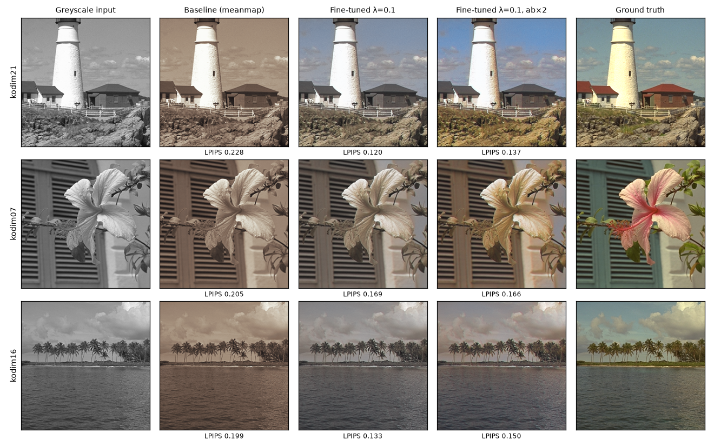
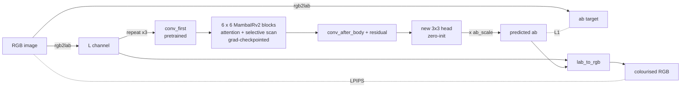
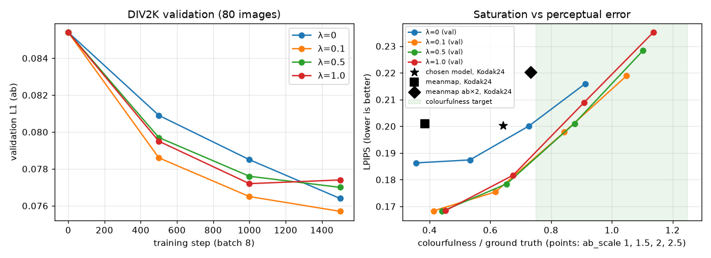
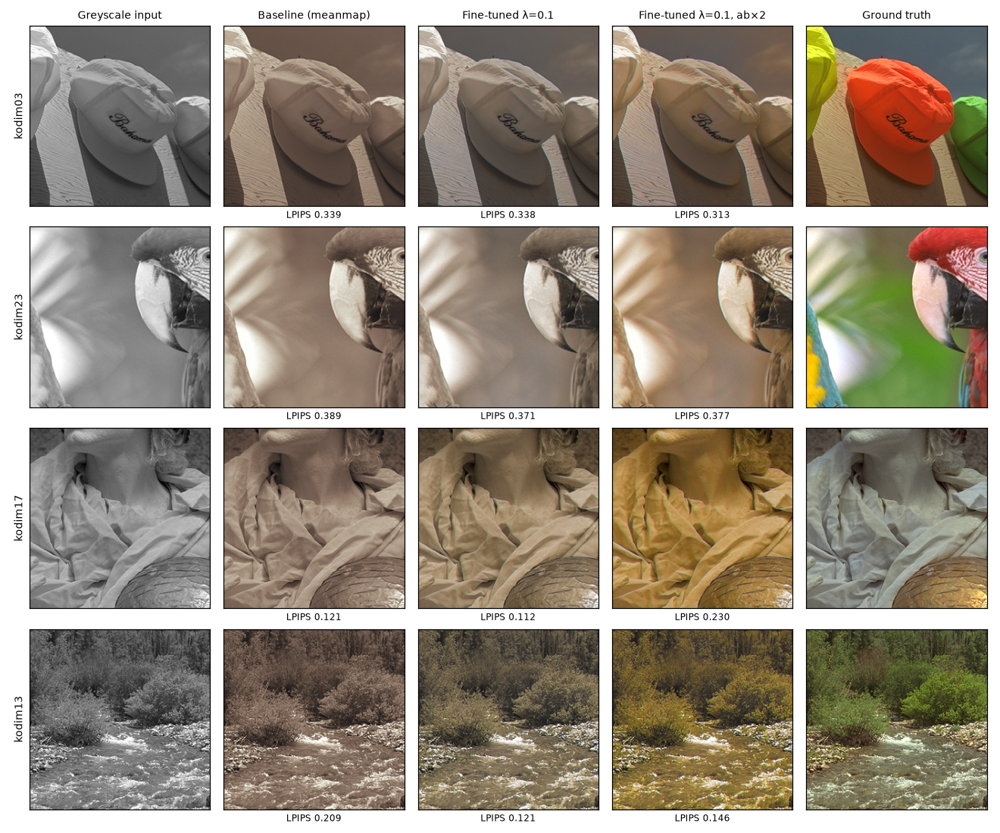

# Greyscale Image Colourisation with a Fine-tuned MambaIRv2

**COMP3710 Project 2.5: Image Colourisation, State Space Restoration**


_Kodak24 centre crops (256×256). Columns: greyscale input, per-brightness mean-colour baseline, fine-tuned MambaIRv2 (λ = 0.1), the same model with chroma ×2, and ground truth. LPIPS is shown under each prediction (lower is better)._

## Contents

1. [Problem and algorithm](#1-problem-and-algorithm)
2. [Feasibility review](#2-feasibility-review)
3. [Dependencies](#3-dependencies)
4. [Usage](#4-usage)
5. [Data, pre-processing and splits](#5-data-pre-processing-and-splits)
6. [Results](#6-results)
7. [Failure-case autopsy](#7-failure-case-autopsy)
8. [Recommendation for the project manager](#8-recommendation-for-the-project-manager)
9. [AI usage disclosure](#9-ai-usage-disclosure)
10. [References](#10-references)

## 1. Problem and algorithm

**The problem.** Colourisation means predicting the two colour channels of a photograph from its brightness alone. The problem is ill-posed: a grey shirt could have been red, green or blue, and all three have the same luminance. A network trained with a pixel loss (L1 or MSE) minimises its expected error by predicting the _average_ of the plausible colours. That average is a desaturated brown, so models trained this way look drab. A model can also go the other way and produce confident colours that are simply wrong (hallucination). The brief asks whether MambaIRv2, a state-space restoration network with a linear-time global receptive field, can produce vivid colours that respect object boundaries. It also asks how to show a project manager that an output is _plausible_ when the true colour cannot be recovered.

**How it works.** The image is converted to CIELAB, which separates lightness `L` from the two chroma channels `a` and `b`. The network sees only `L` and predicts only `ab`. The output reuses the input's `L` unchanged, so structure and sharpness are preserved by construction (luminance SSIM = 1.0) and the model only has to learn colour.

- **Backbone.** The official MambaIRv2 colour-denoising checkpoint (`mambairv2_ColorDN_15.pth`, about 22.7 M parameters) is loaded with all keys matched. `L` is repeated to three channels so the pretrained first convolution can be reused. The original model's RGB-mean subtraction and its input-to-output residual are not used, because the output is now `ab`, not a cleaned RGB image.
- **Body.** Six residual groups of six blocks each. Every block mixes windowed attention with an attentive selective-scan (Mamba) branch, which gives every pixel a receptive field that spans the whole image.
- **Head.** The original RGB output layer is bypassed. A new 3×3 convolution maps the 174 features to 2 channels (`ab`). It is initialised to zero, so at step 0 the model outputs a plain greyscale image and fine-tuning starts from a stable point.
- **Loss.** `L1(ab) + λ · LPIPS(RGB)`. LPIPS (AlexNet) is a perceptual distance that penalises flat, brown output more than L1 does. To compute it during training, the predicted Lab is converted back to RGB with a hand-written differentiable `lab_to_rgb` ([modules.py](modules.py)).
- **Saturation at inference.** An optional scale `s` multiplies the predicted `ab` (`--ab_scale`). This counteracts the regression-to-the-mean desaturation. `s` is chosen on the validation split, never on the test set.



## 2. Feasibility review

> This is the one-page review written **before** training, kept as submitted. Where the execution differed, the change is listed in [Deviations from the plan](#deviations-from-the-plan) below.

**Recommendation:** proceed with a bounded MambaIRv2 fine-tune (about 9 GPU-hours), gated on a one-hour smoke test. Plausibility is judged by distribution, boundary and human tests, not pixel error alone.

**1. User need and acceptance criteria.** The users are archivists and analysts who need greyscale images colourised for human viewing, not for measurement. Success is measured on the supplied unseen test set against a colour-mapping baseline:

1. LPIPS at least 15% lower than the baseline.
2. Colourfulness within ±25% of the ground-truth mean (no desaturation collapse).
3. Luminance SSIM against the input at least 0.98. PSNR and RGB SSIM are reported but not gated.
4. Chroma bleed across strong luminance edges no worse than ground truth +20%.
5. Peak VRAM at most 15 GB per GPU (128×128 crops, batch 8), and at most 8 GPU-hours of training.

**2. Model and course concepts.**

- **Dataset.** Test: Kodak24 (24 PNGs, 256×256 centre crops). Train: DIV2K + Flickr2K in CIELAB, random 128×128 crops and flips, with 10% held out for validation. The test set is used once, at the end.
- **Architecture and band.** MambaIRv2 (Hard), fine-tuned from the official `mambairv2_ColorDN_15.pth` denoising checkpoint and built with `upscale = 1` and no upsampler (transfer learning). It takes `L` and predicts only `ab`, so structure is preserved by construction and only colour is learned.
- **Why it suits the dilemma.** Its linear-time global receptive field lets distant context choose consistent hues (Gu and Dao, 2023). Semantic-guided neighbouring should limit bleed across edges, which criterion 4 tests.
- **Loss and baselines.** Colourisation is ill-posed, so L1 alone predicts the conditional mean and gives brown output (Zhang et al., 2016). We add an LPIPS perceptual loss (Zhang et al., 2018), sweep its weight λ over {0, 0.1, 0.5}, and compare against the frozen model and a per-brightness mean-colour mapping.

**3. Feasibility evidence.** The test set is Kodak24: 24 lossless 768×512 RGB PNGs, a standard colour-restoration benchmark that the pretrained checkpoint was tested on but not trained on. Each image is centre-cropped to 256×256, so every model is scored on identical inputs. The course notebook shows that the environment builds and that a MambaIRv2 checkpoint loads with all keys matched. Smoke test: `torchrun --standalone --nproc_per_node=1 train.py --crop 128 --batch 8 --iters 500 --seed 0`.

How the pretrained ColorDN checkpoint does on Kodak24 for nearby tasks (audit before fine-tuning):

| Degradation  | Method               | PSNR ↑ | SSIM ↑ | LPIPS ↓ | ΔE00 ↓ |
| ------------ | -------------------- | -----: | -----: | ------: | -----: |
| Noise σ=15   | Degraded input       |  24.73 |  0.574 |   0.239 |  10.40 |
|              | ColorDN (pretrained) |  34.86 |  0.933 |   0.053 |   1.80 |
| Colour cast  | Degraded input       |  24.81 |  0.983 |   0.090 |  11.76 |
|              | Gray-world           |  21.32 |  0.914 |   0.087 |  12.21 |
|              | SR ×4 (notebook)     |  18.34 |  0.582 |   0.437 |  14.25 |
|              | ColorDN (pretrained) |  24.26 |  0.911 |   0.178 |  11.94 |
| Desaturation | Degraded input       |  24.85 |  0.963 |   0.119 |   8.28 |
|              | ColorDN (pretrained) |  24.37 |  0.895 |   0.213 |   8.58 |
| Fade         | Degraded input       |  22.77 |  0.927 |   0.112 |   9.02 |
|              | Gray-world           |  20.14 |  0.906 |   0.107 |  12.08 |
|              | ColorDN (pretrained) |  22.31 |  0.822 |   0.240 |   9.31 |

The pretrained model removes noise very well but does not create colour, which motivates the fine-tune. Plausibility will be shown to the PM through colourfulness and ab-histogram match, the bleed score, a blind real-versus-colourised test (5–10 raters, 50 pairs), and an autopsy of 3–5 failure cases.

**4. Risks, budget and fallback.**

- **Main risks and mitigations:**
  - mamba_ssm kernels failing to build: fall back to pinned older versions.
  - Desaturation: add the LPIPS term.
  - Out-of-memory: bf16, gradient checkpointing, or a smaller batch.
  - Hallucinated skin or organ colour: human review, a "synthetic colour" label, and never using the output for diagnosis or as evidence.
- **Budget:** 1 GPU-hour for the smoke test, 6 for the λ sweep and 2 for final training and evaluation, about 9 GPU-hours in total. Stop and escalate if the smoke test exceeds 15 GB or falls below 10 img/s.
- **Fallback:** MambaIR v1, then a U-Net, with the same protocol and criteria.

### Deviations from the plan

| Plan                     | What was done                                   | Why                                                                                                                          |
| ------------------------ | ----------------------------------------------- | ---------------------------------------------------------------------------------------------------------------------------- |
| DIV2K + Flickr2K         | DIV2K train only (800 images)                   | The run sees about 12 k random crops, while the 720 training images hold about 110 k non-overlapping 128² patches, so the run is limited by compute, not by data. |
| 5,000 iterations per run | 1,500 iterations per run                        | Throughput was 1.0 img/s, not 20 (see [§6.3](#63-resource-profile)), so 5,000 iterations would not fit the GPU quota.        |
| λ ∈ {0, 0.1, 0.5}        | λ ∈ {0, 0.1, 0.5, 1.0}                          | λ = 1.0 was added to check whether more LPIPS weight keeps helping.                                                          |
| Colab                    | UQ EAIT GPU VM (NVIDIA A10G, 24 GB)             | Each run takes about 3.4 h on one GPU.                                                                                       |
| Blind rater study        | Not run                                         | Listed as a next step in [§8](#8-recommendation-for-the-project-manager).                                                    |
| (none)                   | Post-hoc chroma scale `s`, chosen on validation | All λ reached at most 45% of ground-truth colourfulness.                                                                          |

## 3. Dependencies

Tested on an NVIDIA A10G (24 GB) with Python 3.12.

- **Core:** torch 2.8.0 (CUDA 12.6), torchvision 0.23.0, mamba_ssm 2.3.2.post1 and causal_conv1d (both built with `--no-build-isolation`).
- **Model code:** the [csguoh/MambaIR](https://github.com/csguoh/MambaIR) repository, which provides the `MambaIRv2` class. Importing it also needs einops, timm, opencv-python, pyyaml and scipy.
- **Scripts:** lpips, scikit-image, numpy, pillow, matplotlib.

**Reproducibility.** Every run uses `--seed 0` and the same fixed split (§5). bf16 and the mamba_ssm kernels are not bitwise deterministic, but repeated evaluations agreed to within 0.0001 LPIPS. The experiments ran before the code was split into the course file layout; the refactor did not change the loss, data pipeline or metrics. Logs and metric CSVs behind every result in §6 and §7 are in [outputs/](outputs/).

## 4. Usage

The scripts sit on top of the official MambaIR repository, which provides the `MambaIRv2` class.

| File                                 | Purpose                                                                                                                                                                                     |
| ------------------------------------ | ------------------------------------------------------------------------------------------------------------------------------------------------------------------------------------------- |
| [modules.py](modules.py)             | Model components, PyTorch only: `Colorizer` (pretrained MambaIRv2 body, zero-init `ab` head, per-block gradient checkpointing), the `MeanMap` baseline and the differentiable `lab_to_rgb`. |
| [dataset.py](dataset.py)             | `LabDataset` (crop, flip, RGB→Lab, normalisation), and the fixed, disjoint train/validation split (`split_train_val`).                                                                      |
| [train.py](train.py)                 | `torchrun`/DDP fine-tuning with L1 + λ·LPIPS. Validates and checkpoints every 500 steps, plots `curves.png`, and scores the test set once at the end.                                       |
| [predict.py](predict.py)             | Loads saved weights (or a baseline), runs inference on the test set, prints metrics, and writes per-image PNGs, `metrics.csv` and an `examples.png` figure.                                 |
| [bench.py](bench.py)                 | Step timing, peak VRAM and CUDA kernel profile.                                                                                                                                             |
| [test_pipeline.py](test_pipeline.py) | CPU sanity test: `lab_to_rgb` against skimage, dataset ranges, PNG round trip, disjoint split, `MeanMap`.                                                                                   |
| [figures.py](figures.py)             | Rebuilds the figures in this README from `outputs/`.                                                                                                                                        |

**Setup (GPU machine):**

```bash
git clone https://github.com/csguoh/MambaIR.git ~/MambaIR && cd ~/MambaIR
cp /path/to/PatternAnalysis-2026/recognition/MambaIRv2_s4803041/*.py .
python3 -m venv ~/venv-mamba && source ~/venv-mamba/bin/activate
pip install torch==2.8.0 torchvision==0.23.0 --index-url https://download.pytorch.org/whl/cu126
pip install packaging ninja wheel setuptools
pip install causal_conv1d mamba_ssm --no-build-isolation
pip install einops lpips scikit-image pillow opencv-python pyyaml scipy timm matplotlib

mkdir -p experiments data
wget https://huggingface.co/cguoh/MambaIR/resolve/main/MambaIRv2_ckpt/mambairv2_ColorDN_15.pth -P experiments
wget http://data.vision.ee.ethz.ch/cvl/DIV2K/DIV2K_train_HR.zip && unzip DIV2K_train_HR.zip -d data
# Kodak24 (kodim01.png ... kodim24.png) into data/kodak24/
mkdir -p data/div2k_val && ls $PWD/data/DIV2K_train_HR/*.png | tail -80 | xargs -I{} ln -sf {} data/div2k_val/
```

**Train** (one run per λ; `--nproc_per_node` sets the number of GPUs):

```bash
for lam in 0 0.1 0.5 1.0; do
  torchrun --standalone --nproc_per_node=1 train.py --crop 128 --batch 8 --iters 1500 \
      --seed 0 --lam $lam --out runs/lam$lam 2>&1 | tee runs/lam$lam.log
done
```

Each run writes `runs/lam<λ>/ckpt_<step>.pt`, `curves.png` (training and validation L1/LPIPS) and, if `data/kodak24` exists, a final `TEST` line with L1 and LPIPS.

**Select the chroma scale on validation, then score once on Kodak24:**

```bash
for lam in 0 0.1 0.5 1.0; do for s in 1.0 1.5 2.0 2.5; do
  python predict.py --method finetuned --ckpt runs/lam$lam/ckpt_1500.pt \
      --test_data data/div2k_val --ab_scale $s --out val/lam${lam}_s$s
done; done

python predict.py --method frozen  --out results/frozen
python predict.py --method meanmap --out results/meanmap
python predict.py --method finetuned --ckpt runs/lam0.1/ckpt_1500.pt --ab_scale 2.0 --out results/final_lam0.1_s2.0
```

**Profile and test:**

```bash
python bench.py --profile                                  # s/step, img/s, peak GB, top CUDA kernels
python test_pipeline.py data/DIV2K_train_HR                # CPU only, no mamba_ssm needed
python figures.py                                          # CPU only, rebuilds figures/
```

**Example of what `predict.py` prints** (it also saves `examples.png`: greyscale | prediction | ground truth):

```
finetuned  ab_scale 2.0  (24 images)
  psnr                 22.5372
  ssim_rgb             0.9241
  ssim_L               1.0000
  lpips                0.2004
  colourfulness_pred   27.6100
  colourfulness_gt     43.0800
  bleed_pred           0.0403
  bleed_gt             0.0552
  colourfulness ratio  0.641   (target 0.75-1.25)
  bleed ratio          0.730   (target <= 1.20)
```

## 5. Data, pre-processing and splits

| Split      | Images | Source                          | Use                                                  |
| ---------- | -----: | ------------------------------- | ---------------------------------------------------- |
| Train      |    720 | DIV2K train HR, files 0001–0720 | Gradient updates                                     |
| Validation |     80 | DIV2K train HR, files 0721–0800 | Choosing λ and `s`, monitoring overfitting           |
| Test       |     24 | Kodak24                         | Scored once per method, after all choices were fixed |

Preprocessing was implemented in [dataset.py](dataset.py), and undergoes the following 6 step process:

1. **Load:** Image is opened with PIL, converted to RGB, and scaled from 0-255 to float32 in the range of [0,1]. The greyscale input is synthesised from these colour originals (step 3).

2. **Crop:**
   - **Training:** Each image gets a random 128x128 square crop to be used for training, so that each pass over the data shows a different part of each image. (Around 50% of the time, the cropped section is horizontally flipped)
   - **Validation and Testing:** A centre crop of 128x128 that is the same across runs for reproducibility and accuracy when doing validation result comparions. `predict.py` and the final test pass in `train.py` use a 256x256 centre crop (Kodak images are 768x512 or 512x768).
   - Cropping occurs before color conversion because converting the small segment is cheaper than a whole 2k image.

3. **Convert:** The image is then converted to CIELAB using `skimage.color.rgb2lab` splitting the crop into a lightness L (0-100) and two colour channels a and b (-128 to 127). The network sees L and predicts only ab.

4. **CIELAB normalization:**
   - Model input: L / 100 -> [0,1]. The model repeats L to three channels to reuse the pretrained first convolution (§1).
   - Normalize the ground-truth: ab/128 gives a range [-1,1] which is used as the L1 target in the loss function.

5. **Return tensors:** Each sample is converted to three (C,H,W) float 32 tesnors, lightness (1 channel), ab (2 channels), the RGB crop (3 channels) used as reference for LPIPS and metrics.

6. **Back to RGB:** To compute LPIPS and save images, predicted Lab is converted back with a differentiable torch `lab_to_rgb` (sRGB, D65), which matches `skimage.color.lab2rgb` to 2.5e-4 (checked in [test_pipeline.py](test_pipeline.py)).

**Why these splits:**

- **Train and validation.** DIV2K is high-resolution, diverse and has no compression artefacts, and the checkpoint was pretrained on similar data. Holding out 10% of it gives a validation set from the same distribution, used for every hyperparameter choice. The split is a fixed slice of the sorted file list, so it is identical on every run.
- **Test.** Kodak24 is the test set chosen in the [feasibility review](#2-feasibility-review). It is a _different_ distribution: film scans from the 1990s, with more saturated subjects such as hats, parrots and boats. Using it only once, after all choices were made, means the test numbers measure generalisation rather than tuning. That shift is visible in the results: colourfulness picked on validation (0.84) dropped on Kodak (0.64).
- **Why not more data.** 1,500 iterations × batch 8 is 12,000 crops, about 16.7 passes over the 720 training images. Because each pass sees a fresh random crop, the model rarely sees the same patch twice. At step 1,500 the (single-batch) training L1 was only about 9–13% below validation, and validation L1 did not rise meaningfully in any run (the largest increase was 0.0002), so the model did not overfit; extra images would not have helped within this compute budget.

## 6. Results

### 6.1 Quantitative benchmark on Kodak24

All methods are scored on identical 256×256 centre crops. "Frozen" is the pretrained ColorDN body with the zero-initialised head, so its output is the greyscale input itself (`ab = 0`). "Meanmap" assigns each of 64 brightness bins the mean `ab` of that bin over all 800 DIV2K images.

| Method                 |   λ | `s` |    PSNR ↑ | SSIM (RGB) ↑ | SSIM (L) |    LPIPS ↓ | Colourfulness / GT | Bleed / GT |
| ---------------------- | --: | --: | --------: | -----------: | -------: | ---------: | -----------------: | ---------: |
| Frozen (greyscale)     |   – |   – |     21.62 |        0.932 |    1.000 |     0.2386 |               0.00 |       0.00 |
| Meanmap baseline       |   – |   1 |     23.29 |    **0.939** |    1.000 |     0.2009 |               0.38 |       0.75 |
| Meanmap baseline       |   – |   2 |     21.57 |        0.925 |    1.000 |     0.2203 |               0.73 |       1.51 |
| Fine-tuned             |   0 |   1 |     23.19 |        0.939 |    1.000 |     0.2027 |               0.26 |       0.20 |
| Fine-tuned             | 0.1 |   1 |     23.26 |        0.938 |    1.000 |     0.1865 |               0.33 |       0.37 |
| Fine-tuned             | 0.5 |   1 | **23.44** |        0.937 |    1.000 |     0.1812 |               0.39 |       0.47 |
| Fine-tuned             | 1.0 |   1 |     23.24 |        0.935 |    1.000 | **0.1805** |               0.41 |       0.49 |
| **Chosen: fine-tuned** | 0.1 |   2 |     22.54 |        0.924 |    1.000 |     0.2004 |           **0.64** |       0.73 |

Colourfulness is the Hasler–Süsstrunk index. "Bleed" is the mean chroma gradient on the 5% strongest luminance edges; both are reported as a ratio to the ground truth.

**Against the acceptance criteria:**

| #   | Criterion                       | Result                                                         | Verdict                  |
| --- | ------------------------------- | -------------------------------------------------------------- | ------------------------ |
| 1   | LPIPS ≥ 15% below meanmap       | Best −10.2% (λ = 1.0, `s` = 1). Chosen model −0.2%.            | ✗                        |
| 2   | Colourfulness within ±25% of GT | 0.64 on Kodak (0.84 on validation)                             | ✗ (passes on validation) |
| 3   | Luminance SSIM ≥ 0.98           | 1.000 (by construction)                                        | ✓                        |
| 4   | Bleed ≤ 1.2 × GT                | 0.73 (meanmap ×2 reaches 1.51)                                 | ✓, with the caveat below |
| 5   | VRAM ≤ 15 GB; ≤ 8 GPU-hours     | 9.1 GB; about 14 GPU-hours for the 4-run sweep (3.4 h per run) | ✓ / ✗                    |

### 6.2 Training curves and the saturation trade-off



The figure has two plots. The left plot shows validation L1, the error between predicted and true colour, over training, with one line per λ. The right plot shows what happens when the predicted colour is boosted at inference: each line is one λ, and its four points are chroma scales `s` = 1, 1.5, 2 and 2.5. Its x-axis is colourfulness as a fraction of the ground truth (1.0 means as vivid as the real photos), its y-axis is LPIPS (lower is better), the green band is the 0.75–1.25 colourfulness target, and the black markers are Kodak test results for comparison.

**Convergence.** Every run starts from the same point, because the zero-initialised head makes the model output grey at step 0. By step 1,500, validation L1 has fallen 9–11% below that grey starting point in every run, so the model has learned real colour information. Three of the four curves are still drifting down at the end, so longer training would help, but only a little because the improvement is slowing. The λ = 1.0 curve flattened, rising slightly from 0.0772 to 0.0774 at the last checkpoint; no run's validation loss rose meaningfully, so the models did not overfit.

**The saturation trade-off.** At `s` = 1, every λ produces images only 36–45% as colourful as the ground truth. This is the regression-to-the-mean problem from §1: L1 rewards predicting the average of the plausible colours, and that average is dull. Raising `s` moves every line to the right (more colourful) but also upwards (worse LPIPS). Boosting the colour makes correct predictions more vivid, but it makes wrong predictions more wrong by the same amount, and LPIPS penalises those. The plot also shows the effect of the LPIPS loss. The λ = 0 line, trained with L1 only, sits clearly above the others, so adding any LPIPS weight gives better perceptual quality at every level of colourfulness. The three λ > 0 lines almost overlap, so a larger weight gains little; λ = 0.1 was chosen as the smallest weight that gets the benefit.

**Choosing `s`.** The scale was chosen on the validation split, never on the test set. `s` = 2.0 is the smallest scale whose validation colourfulness enters the ±25% target band, at 0.84 of the ground truth. On Kodak, the same scale reaches only 0.64, still short of the band. Kodak's subjects, such as hats, parrots and boats, are more saturated than DIV2K's, so the same boost falls short; this is the domain shift described in §5.

**Comparison with the baseline.** A fair comparison is at similar colourfulness, where meanmap ×2 reaches 0.73 and the chosen model 0.64. At those levels the fine-tuned model is clearly better, with LPIPS 0.200 against 0.220 and about half the edge bleed (0.73 against 1.51). Meanmap gives every pixel of the same brightness the same colour regardless of what the object is, so it tints whole regions sepia, and boosting it spreads colour straight across edges. The fine-tuned model uses the image content instead, putting blue in the sky and green or brown in vegetation, so its colour follows objects rather than brightness alone.

### 6.3 Resource profile

Measured with [bench.py](bench.py) and the training logs on an NVIDIA A10G (24 GB), bf16 autocast:

| Quantity                                                       | Value                                                                                                       |
| -------------------------------------------------------------- | ----------------------------------------------------------------------------------------------------------- |
| Parameters                                                     | 22.66 M total. 22,656,404 trainable (body plus a 3,134-parameter head); the bypassed `conv_last` is frozen. |
| Peak VRAM, training (batch 8, 128², per-block checkpointing)   | 9.1 GB                                                                                                      |
| Peak VRAM without checkpointing / with per-group checkpointing | OOM (> 20.4 GB) / OOM (20.6 GB)                                                                             |
| Training throughput                                            | 1.0 img/s (8.24 s per step)                                                                                 |
| Training per run                                               | 1,500 steps, 12,000 crops (about 16.7 passes over 720 images), about 3.4 GPU-hours                          |
| Whole sweep (4 runs + smoke test)                              | about 14 GPU-hours                                                                                          |

- **Why training is slow.** The profile ([outputs/bench_profile.txt](outputs/bench_profile.txt)) shows no matrix-multiply kernel among the 15 most expensive. The time is spread over thousands of small, memory-bound element-wise, LayerNorm and gather kernels. The selective scan itself is only about 7.6%. Gradient checkpointing recomputes every block's forward pass during backward, which roughly adds one extra forward. `cudnn.benchmark` made no difference.
- **What this means.** Linear-time _complexity_ doesn't translate into high _throughput_ at these sizes. 1.0 img/s is 20× below the planned 20 img/s, and that is why the iteration count was cut.

## 7. Failure-case autopsy



| Image                      | Failure mode                                   | What happens                                                                                                                                                                                                             | Root cause                                                                                                                                                                                                                       |
| -------------------------- | ---------------------------------------------- | ------------------------------------------------------------------------------------------------------------------------------------------------------------------------------------------------------------------------ | -------------------------------------------------------------------------------------------------------------------------------------------------------------------------------------------------------------------------------- |
| **kodim03** (hats)         | Desaturation collapse                          | Red, yellow and green caps all come out beige. Ground-truth colourfulness is 94; ours is 24. LPIPS 0.31, among the worst.                                                                                                | Fabric caps can be any colour, so the conditional mean is neutral. Nothing in the greyscale image tells the model which cap was red. L1 rewards exactly this hedge, and ×2 scaling cannot create a hue that was never predicted. |
| **kodim23** (parrot)       | Desaturation and lost semantics                | The green background and red feathers become cream and brown; only a faint warm tint survives. LPIPS 0.38, the worst image.                                                                                              | Likely few similar birds in DIV2K (not measured). A 128² training crop rarely contains enough of the bird to recognise it, so the receptive field cannot use context it never learned.                                           |
| **kodim17** (stone statue) | Chromatic hallucination, made worse by scaling | A grey stone statue is painted gold-ochre. At `s` = 1 it is a mild warm tint (LPIPS 0.112, better than meanmap); at `s` = 2 it is strongly gold (0.230, the largest regression). Colourfulness is 1.7× the ground truth. | Skin-like texture and brightness make the network predict a skin tone. A global scale multiplies _wrong_ colours as much as right ones. This is the case that rules out unsupervised use on people or artefacts.                 |
| **kodim13** (river)        | Wrong hue and edge bleed                       | The vegetation is yellow-olive instead of green, and the yellow spreads into the rocks and water at `s` = 2. Bleed is 1.47× the ground truth on this image, compared with 0.73 on average.                               | Foliage brightness overlaps with dry grass, so the model hedges toward yellow. Scaling turns low-amplitude chroma noise at fine, high-contrast texture into visible speckle that crosses edges.                                  |

**Patterns across Kodak24:**

- **Domain shift explains the biggest misses.** The worst images (kodim03, 14, 23) are the most saturated in the set, with ground-truth colourfulness 72–94 against a mean of 43. All of them contain human-made, arbitrarily coloured objects such as caps, rafts and parrots.
- **Boosting chroma is a trade, not a fix.** The fine-tuned model at `s` = 1 beats meanmap on LPIPS for 17 of the 24 images. At `s` = 2 it wins only 11. Scaling helps the images whose hue was right and hurts the ones whose hue was wrong.
- **Bleed isn't the main failure.** Even at `s` = 2, mean bleed is below the ground truth. The bleed metric also grows with saturation, so it rewards greyish output; a scale-free version based on edge alignment would be a better test.

## 8. Recommendation for the project manager

**Short version.** Fine-tuned MambaIRv2 produces _plausible, conservative_ colour with sharp, artefact-free structure. Brightness is untouched and colour stays inside object boundaries better than a colour-mapping baseline does. However, it does not meet the vividness target, it cannot recover the colour of arbitrarily coloured objects, and it occasionally invents colour that wasn't there. **Deploy it as a viewing aid with a "synthetic colour" label and human review. Do not use it where the colour is the information.**

**How to show plausibility when the true colour is unknowable.** No single number proves an output is plausible. Use four separate checks:

1. **Distribution.** Colourfulness and `ab` histograms should match real photographs, which rules out desaturation collapse. Ours reaches 0.64 (Kodak) to 0.84 (validation) of the ground truth.
2. **Boundaries.** Chroma should change where brightness changes and nowhere else (the bleed ratio). Ours is below 1.0×, against 1.5× for the baseline boosted to similar colourfulness.
3. **Perception.** LPIPS against the one true colouring is a _lower bound_ on plausibility, because a plausible but different colour is still penalised. It is useful for comparing methods, not as an absolute pass mark.
4. **Humans.** A blind real-versus-colourised test (planned, not run) is the only direct measure. It should be run before any deployment decision.

**Trade-off summary:**

| Option                            | Perceptual quality | Vividness  | Risk                               | Cost                        |
| --------------------------------- | ------------------ | ---------- | ---------------------------------- | --------------------------- |
| Meanmap lookup table              | LPIPS 0.201        | 0.38×      | Uniform sepia, bleeds when boosted | Free, instant               |
| Fine-tuned, `s` = 1 (λ = 0.5–1.0) | **LPIPS 0.181**    | 0.39–0.41× | Very safe, but dull                | 9.1 GB, about 3.4 GPU-hours |
| Fine-tuned, `s` = 2 (chosen)      | LPIPS 0.200        | **0.64×**  | Visible hallucinations (kodim17)   | Same                        |

Choose `s` = 1 for safety (archival or evidential use) and `s` ≈ 2 for presentation; the scale is a single inference-time flag, so it can be set per use case without retraining.

**Operating boundaries:**

- **Suitable:** natural scenes such as sky, water, vegetation and landscapes, where hue follows from brightness and context.
- **Unsuitable:** arbitrarily coloured human-made objects (clothing, vehicles, signage), and any medical, forensic or historical use where a colour would be read as fact.
- **People:** skin tones are a hallucination risk, and a human reviewer should sign off.

**If more budget is approved, in order of expected gain per GPU-hour:**

1. **Larger training context.** Downscale the image before cropping, or train on 256² crops, so each crop contains whole objects.
2. **A loss that does not reward the average.** Predict a distribution over quantised `ab` bins and take its annealed mean (Zhang et al., 2016), or add a GAN or diffusion head.
3. **Data that covers the test set's saturated subjects.** Add ImageNet or COCO.
4. **Throughput.** Fused kernels or `torch.compile` to recover the 20× gap to the plan.

## 9. AI usage disclosure

Claude Opus 5.5 was used as assistance for writing the data loading, training, and plots. It also assisted in visualisations, data presentations, and report drafting. Statements made in this report as well as hand-written code was fact-checked by claude to ensure accuracy.

AI-assisted work was audited in several ways. The model code was compared with the official MambaIR implementation to confirm it uses the original network correctly, and [test_pipeline.py](test_pipeline.py) checks the colour conversion, the data loading and the train/validation split. After the code was restructured, the baseline results were reproduced to confirm nothing had changed. All training and evaluation was run by me, and every result in §6 and §7 was recomputed from the logs and results in [outputs/](outputs/) and compared with the text. Statements the evidence did not back up were removed or marked as unverified. Finally, I questioned how each part of the pipeline works and any pre-filled data in this README was fact-checked or re-written to ensure it reflects an accurate account of my work as well as my findings while completing this project.

## 10. References

1. H. Guo, Y. Guo, Y. Zha, Y. Zhang, W. Li, T. Dai, S.-T. Xia and Y. Li, "MambaIRv2: Attentive State Space Restoration," _CVPR_, 2025.
2. A. Gu and T. Dao, "Mamba: Linear-Time Sequence Modeling with Selective State Spaces," arXiv:2312.00752, 2023.
3. R. Zhang, P. Isola and A. A. Efros, "Colorful Image Colorization," _ECCV_, 2016.
4. R. Zhang, P. Isola, A. A. Efros, E. Shechtman and O. Wang, "The Unreasonable Effectiveness of Deep Features as a Perceptual Metric," _CVPR_, 2018.
5. D. Hasler and S. Süsstrunk, "Measuring Colourfulness in Natural Images," _Proc. SPIE 5007_, 2003.
6. E. Agustsson and R. Timofte, "NTIRE 2017 Challenge on Single Image Super-Resolution: Dataset and Study," _CVPR Workshops_, 2017 (DIV2K).
7. Eastman Kodak, Kodak Lossless True Color Image Suite (Kodak24).
