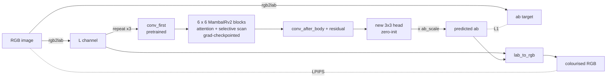

# Greyscale Image Colourisation with a Fine-tuned MambaIRv2

**COMP3710 Project 2.5: Image Colourisation, State Space Restoration**

**Author:** Zayne Steele Grant (s4803041)


_Kodak24 centre crops (256×256). From left: greyscale input, mean-colour baseline, fine-tuned MambaIRv2 (λ = 0.1), the same model with colour ×2, and ground truth. LPIPS is under each prediction (lower is better)._

## Contents

1. [Problem and algorithm](#1-problem-and-algorithm)
2. [Feasibility review](#2-feasibility-review)
3. [Dependencies](#3-dependencies)
4. [Usage](#4-usage)
5. [Data, pre-processing and splits](#5-data-pre-processing-and-splits)
6. [Results](#6-results)
7. [Failure-case autopsy](#7-failure-case-autopsy)
8. [Recommendation for the project manager](#8-recommendation-for-the-project-manager)
9. [AI usage disclosure](#9-ai-usage-disclosure)
10. [References](#10-references)

## 1. Problem and algorithm

**The problem.** Colourisation means guessing a photo's colour from its brightness alone, and there is often no single right answer, since a grey shirt could have been red, green or blue. A network trained with a pixel loss such as L1 plays it safe by predicting the average colour, which is usually a dull brown, or it confidently paints things the wrong colour. This project tests whether MambaIRv2, a state-space network that sees the whole image at once, can produce vivid colour that stays inside object boundaries, and how to show a project manager that an output is _plausible_ when the true colour is unknown.

**How it works.** Each image is converted to CIELAB, which separates lightness `L` from the two colour channels `ab`. The network sees only `L` and predicts only `ab`, and the output keeps the original `L`, so the image structure is untouched and the model only has to learn colour.

I fine-tune the official MambaIRv2 colour-denoising checkpoint (`mambairv2_ColorDN_15.pth`, about 22.7 M parameters). `L` is repeated to three channels so the pretrained first layer still works, and the RGB output layer is replaced by a new zero-initialised 3×3 convolution (174 features to 2 channels), so training starts from a plain greyscale output. The loss is `L1(ab) + λ · LPIPS(RGB)`. LPIPS is a perceptual distance that penalises dull output more than L1, and it is computed through a differentiable `lab_to_rgb` in [modules.py](modules.py). At inference, an optional scale `s` (`--ab_scale`) boosts the predicted colour. It was chosen on validation, never on the test set.



## 2. Feasibility review

> This is the one-page review written **before** training, kept as submitted. Where the execution differed, the change is listed in [Deviations from the plan](#deviations-from-the-plan) below.

**Recommendation:** proceed with a bounded MambaIRv2 fine-tune (about 9 GPU-hours), gated on a one-hour smoke test. Plausibility is judged by distribution, boundary and human tests, not pixel error alone.

**1. User need and acceptance criteria.** The users are archivists and analysts who need greyscale images colourised for human viewing, not for measurement. Success is measured on the supplied unseen test set against a colour-mapping baseline:

1. LPIPS at least 15% lower than the baseline.
2. Colourfulness within ±25% of the ground-truth mean (no desaturation collapse).
3. Luminance SSIM against the input at least 0.98. PSNR and RGB SSIM are reported but not gated.
4. Chroma bleed across strong luminance edges no worse than ground truth +20%.
5. Peak VRAM at most 15 GB per GPU (128×128 crops, batch 8), and at most 8 GPU-hours of training.

**2. Model and course concepts.**

- **Dataset.** Test: Kodak24 (24 PNGs, 256×256 centre crops). Train: DIV2K + Flickr2K in CIELAB, random 128×128 crops and flips, with 10% held out for validation. The test set is used once, at the end.
- **Architecture and band.** MambaIRv2 (Hard), fine-tuned from the official `mambairv2_ColorDN_15.pth` denoising checkpoint and built with `upscale = 1` and no upsampler (transfer learning). It takes `L` and predicts only `ab`, so structure is preserved by construction and only colour is learned.
- **Why it suits the dilemma.** Its linear-time global receptive field lets distant context choose consistent hues (Gu and Dao, 2023). Semantic-guided neighbouring should limit bleed across edges, which criterion 4 tests.
- **Loss and baselines.** Colourisation is ill-posed, so L1 alone predicts the conditional mean and gives brown output (Zhang et al., 2016). We add an LPIPS perceptual loss (Zhang et al., 2018), sweep its weight λ over {0, 0.1, 0.5}, and compare against the frozen model and a per-brightness mean-colour mapping.

**3. Feasibility evidence.** The test set is Kodak24: 24 lossless 768×512 RGB PNGs, a standard colour-restoration benchmark that the pretrained checkpoint was tested on but not trained on. Each image is centre-cropped to 256×256, so every model is scored on identical inputs. The course notebook shows that the environment builds and that a MambaIRv2 checkpoint loads with all keys matched. Smoke test: `torchrun --standalone --nproc_per_node=1 train.py --crop 128 --batch 8 --iters 500 --seed 0`.

How the pretrained ColorDN checkpoint does on Kodak24 for nearby tasks (audit before fine-tuning):

| Degradation  | Method               | PSNR ↑ | SSIM ↑ | LPIPS ↓ | ΔE00 ↓ |
| ------------ | -------------------- | -----: | -----: | ------: | -----: |
| Noise σ=15   | Degraded input       |  24.73 |  0.574 |   0.239 |  10.40 |
|              | ColorDN (pretrained) |  34.86 |  0.933 |   0.053 |   1.80 |
| Colour cast  | Degraded input       |  24.81 |  0.983 |   0.090 |  11.76 |
|              | Gray-world           |  21.32 |  0.914 |   0.087 |  12.21 |
|              | SR ×4 (notebook)     |  18.34 |  0.582 |   0.437 |  14.25 |
|              | ColorDN (pretrained) |  24.26 |  0.911 |   0.178 |  11.94 |
| Desaturation | Degraded input       |  24.85 |  0.963 |   0.119 |   8.28 |
|              | ColorDN (pretrained) |  24.37 |  0.895 |   0.213 |   8.58 |
| Fade         | Degraded input       |  22.77 |  0.927 |   0.112 |   9.02 |
|              | Gray-world           |  20.14 |  0.906 |   0.107 |  12.08 |
|              | ColorDN (pretrained) |  22.31 |  0.822 |   0.240 |   9.31 |

The pretrained model removes noise very well but does not create colour, which motivates the fine-tune. Plausibility will be shown to the PM through colourfulness and ab-histogram match, the bleed score, a blind real-versus-colourised test (5–10 raters, 50 pairs), and an autopsy of 3–5 failure cases.

**4. Risks, budget and fallback.**

- **Main risks and mitigations:**
  - mamba_ssm kernels failing to build: fall back to pinned older versions.
  - Desaturation: add the LPIPS term.
  - Out-of-memory: bf16, gradient checkpointing, or a smaller batch.
  - Hallucinated skin or organ colour: human review, a "synthetic colour" label, and never using the output for diagnosis or as evidence.
- **Budget:** 1 GPU-hour for the smoke test, 6 for the λ sweep and 2 for final training and evaluation, about 9 GPU-hours in total. Stop and escalate if the smoke test exceeds 15 GB or falls below 10 img/s.
- **Fallback:** MambaIR v1, then a U-Net, with the same protocol and criteria.

### Deviations from the plan

| Plan                     | What was done                                   | Why                                                                                                                          |
| ------------------------ | ----------------------------------------------- | ---------------------------------------------------------------------------------------------------------------------------- |
| DIV2K + Flickr2K         | DIV2K train only (800 images)                   | The run sees about 12 k random crops, while the 720 training images hold about 110 k non-overlapping 128² patches, so the run is limited by compute, not by data. |
| 5,000 iterations per run | 1,500 iterations per run                        | Throughput was 1.0 img/s, not 20 (see [Section 6.3](#63-resource-profile)), so 5,000 iterations would not fit the GPU quota.        |
| λ ∈ {0, 0.1, 0.5}        | λ ∈ {0, 0.1, 0.5, 1.0}                          | λ = 1.0 was added to check whether more LPIPS weight keeps helping.                                                          |
| Colab                    | UQ EAIT GPU VM (NVIDIA A10G, 24 GB)             | Each run takes about 3.4 h on one GPU.                                                                                       |
| Blind rater study        | Not run                                         | Listed as a next step in [Section 8](#8-recommendation-for-the-project-manager).                                                    |
| (none)                   | Post-hoc chroma scale `s`, chosen on validation | All λ reached at most 45% of ground-truth colourfulness.                                                                          |

## 3. Dependencies

Everything ran on an NVIDIA A10G (24 GB) with Python 3.12, torch 2.8.0 (CUDA 12.6) and torchvision 0.23.0. The model also needs mamba_ssm 2.3.2.post1 and causal_conv1d (both built with `--no-build-isolation`) and the [csguoh/MambaIR](https://github.com/csguoh/MambaIR) repository, which in turn needs einops, timm, opencv-python, pyyaml and scipy. The scripts use lpips, scikit-image, numpy, pillow and matplotlib.

**Reproducibility.** Every run uses `--seed 0` and the same fixed split. bf16 and the mamba_ssm kernels are not bitwise deterministic, but two evaluations of the same checkpoint agreed to within 0.0001 LPIPS. The experiments ran before the code was refactored into the course layout, and re-running the refactored code reproduced the same results. Logs and metric CSVs for Sections 6 and 7 are in [outputs/](outputs/).

## 4. Usage

The scripts run inside a clone of the official MambaIR repository.

| File | Purpose |
| --- | --- |
| [modules.py](modules.py) | `Colorizer` model, `MeanMap` baseline and `lab_to_rgb` |
| [dataset.py](dataset.py) | `LabDataset` and the fixed train/validation split |
| [train.py](train.py) | `torchrun`/DDP fine-tuning, validation and checkpoints |
| [predict.py](predict.py) | Runs a trained model or baseline on the test set and reports metrics |
| [bench.py](bench.py) | Training speed, memory and CUDA profile |
| [test_pipeline.py](test_pipeline.py) | CPU sanity tests |
| [figures.py](figures.py) | Rebuilds the README figures from the `predict.py` and training outputs |

**Setup (GPU machine):**

```bash
git clone https://github.com/csguoh/MambaIR.git ~/MambaIR && cd ~/MambaIR
cp /path/to/PatternAnalysis-2026/recognition/MambaIRv2_s4803041/*.py .
python3 -m venv ~/venv-mamba && source ~/venv-mamba/bin/activate
pip install torch==2.8.0 torchvision==0.23.0 --index-url https://download.pytorch.org/whl/cu126
pip install packaging ninja wheel setuptools
pip install causal_conv1d mamba_ssm --no-build-isolation
pip install einops lpips scikit-image pillow opencv-python pyyaml scipy timm matplotlib

mkdir -p experiments data
wget https://huggingface.co/cguoh/MambaIR/resolve/main/MambaIRv2_ckpt/mambairv2_ColorDN_15.pth -P experiments
wget http://data.vision.ee.ethz.ch/cvl/DIV2K/DIV2K_train_HR.zip && unzip DIV2K_train_HR.zip -d data
# Kodak24 (kodim01.png ... kodim24.png) into data/kodak24/
mkdir -p data/div2k_val && ls $PWD/data/DIV2K_train_HR/*.png | tail -80 | xargs -I{} ln -sf {} data/div2k_val/
```

**Train** (one run per λ, `--nproc_per_node` sets the number of GPUs):

```bash
for lam in 0 0.1 0.5 1.0; do
  torchrun --standalone --nproc_per_node=1 train.py --crop 128 --batch 8 --iters 1500 \
      --seed 0 --lam $lam --out runs/lam$lam 2>&1 | tee runs/lam$lam.log
done
```

Each run saves checkpoints to `runs/lam<λ>/` and prints a final Kodak `TEST` line.

**Select the chroma scale on validation, then score once on Kodak24:**

```bash
for lam in 0 0.1 0.5 1.0; do for s in 1.0 1.5 2.0 2.5; do
  python predict.py --method finetuned --ckpt runs/lam$lam/ckpt_1500.pt \
      --test_data data/div2k_val --ab_scale $s --out val/lam${lam}_s$s
done; done

for lam in 0 0.1 0.5 1.0; do
  python predict.py --method finetuned --ckpt runs/lam$lam/ckpt_1500.pt --out results/lam$lam
done
python predict.py --method frozen  --out results/frozen
python predict.py --method meanmap --out results/meanmap
python predict.py --method meanmap --ab_scale 2.0 --out results/meanmap_s2.0
python predict.py --method finetuned --ckpt runs/lam0.1/ckpt_1500.pt --ab_scale 2.0 --out results/final_lam0.1_s2.0
```

**Profile and test:**

```bash
python bench.py --profile                                  # s/step, img/s, peak GB, top CUDA kernels
python test_pipeline.py data/DIV2K_train_HR                # CPU only, no mamba_ssm needed
python figures.py --results results --val val --runs runs # CPU only, rebuilds figures/ after the runs above
```

## 5. Data, pre-processing and splits

| Split      | Images | Source                          | Use                                                  |
| ---------- | -----: | ------------------------------- | ---------------------------------------------------- |
| Train      |    720 | DIV2K train HR, files 0001–0720 | Gradient updates                                     |
| Validation |     80 | DIV2K train HR, files 0721–0800 | Choosing λ and `s`, monitoring overfitting           |
| Test       |     24 | Kodak24                         | Scored once per method, after all choices were fixed |

Preprocessing was implemented in [dataset.py](dataset.py), and undergoes the following 6 step process:

1. **Load:** Image is opened with PIL, converted to RGB, and scaled from 0-255 to float32 in the range of [0,1]. The greyscale input is synthesised from these colour originals (step 3).

2. **Crop:**
   - **Training:** Each image gets a random 128x128 square crop to be used for training, so that each pass over the data shows a different part of each image. (Around 50% of the time, the cropped section is horizontally flipped)
   - **Validation and Testing:** A centre crop of 128x128 that is the same across runs for reproducibility and accuracy when doing validation result comparions. `predict.py` and the final test pass in `train.py` use a 256x256 centre crop (Kodak images are 768x512 or 512x768).
   - Cropping occurs before color conversion because converting the small segment is cheaper than a whole 2k image.

3. **Convert:** The image is then converted to CIELAB using `skimage.color.rgb2lab` splitting the crop into a lightness L (0-100) and two colour channels a and b (-128 to 127). The network sees L and predicts only ab.

4. **CIELAB normalization:**
   - Model input: L / 100 -> [0,1]. The model repeats L to three channels to reuse the pretrained first convolution (Section 1).
   - Normalize the ground-truth: ab/128 gives a range [-1,1] which is used as the L1 target in the loss function.

5. **Return tensors:** Each sample is converted to three (C,H,W) float 32 tesnors, lightness (1 channel), ab (2 channels), the RGB crop (3 channels) used as reference for LPIPS and metrics.

6. **Back to RGB:** To compute LPIPS and save images, predicted Lab is converted back with a differentiable torch `lab_to_rgb` (sRGB, D65), which matches `skimage.color.lab2rgb` to 2.5e-4 (checked in [test_pipeline.py](test_pipeline.py)).

**Why these splits.** DIV2K is high-resolution and varied, so holding out 10% gives a validation set that matches the training data, and it was used for every tuning decision. Kodak24, chosen in the [feasibility review](#2-feasibility-review), is deliberately different (1990s film scans with more colourful subjects) and was scored only once, after every choice was fixed. More data was not needed. The 12,000 random crops (about 16.7 passes over 720 images) rarely repeat a patch, training L1 ended only 9–13% below validation, and validation loss never meaningfully rose, so the model did not overfit.

## 6. Results

### 6.1 Quantitative benchmark on Kodak24

All methods use the same 256×256 crops. "Frozen" is the pretrained model with the untrained zero head, so it returns the greyscale input. "Meanmap" gives each of 64 brightness levels its average colour over DIV2K.

| Method                 |   λ | `s` |    PSNR ↑ | SSIM (RGB) ↑ | SSIM (L) |    LPIPS ↓ | Colourfulness / GT | Bleed / GT |
| ---------------------- | --: | --: | --------: | -----------: | -------: | ---------: | -----------------: | ---------: |
| Frozen (greyscale)     |   – |   – |     21.62 |        0.932 |    1.000 |     0.2386 |               0.00 |       0.00 |
| Meanmap baseline       |   – |   1 |     23.29 |    **0.939** |    1.000 |     0.2009 |               0.38 |       0.75 |
| Meanmap baseline       |   – |   2 |     21.57 |        0.925 |    1.000 |     0.2203 |               0.73 |       1.51 |
| Fine-tuned             |   0 |   1 |     23.19 |        0.939 |    1.000 |     0.2027 |               0.26 |       0.20 |
| Fine-tuned             | 0.1 |   1 |     23.26 |        0.938 |    1.000 |     0.1865 |               0.33 |       0.37 |
| Fine-tuned             | 0.5 |   1 | **23.44** |        0.937 |    1.000 |     0.1812 |               0.39 |       0.47 |
| Fine-tuned             | 1.0 |   1 |     23.24 |        0.935 |    1.000 | **0.1805** |               0.41 |       0.49 |
| **Chosen: fine-tuned** | 0.1 |   2 |     22.54 |        0.924 |    1.000 |     0.2004 |           **0.64** |       0.73 |

Colourfulness (Hasler–Süsstrunk) and bleed (colour gradient on the strongest 5% of edges) are shown as ratios to the ground truth.

**Against the acceptance criteria:**

| #   | Criterion                       | Result                                                         | Verdict                  |
| --- | ------------------------------- | -------------------------------------------------------------- | ------------------------ |
| 1   | LPIPS ≥ 15% below meanmap       | Best −10.2% (λ = 1.0, `s` = 1). Chosen model −0.2%.            | ✗                        |
| 2   | Colourfulness within ±25% of GT | 0.64 on Kodak (0.84 on validation)                             | ✗ (passes on validation) |
| 3   | Luminance SSIM ≥ 0.98           | 1.000 (by construction)                                        | ✓                        |
| 4   | Bleed ≤ 1.2 × GT                | 0.73 (meanmap ×2 reaches 1.51)                                 | ✓, with the caveat below |
| 5   | VRAM ≤ 15 GB, ≤ 8 GPU-hours     | 9.1 GB, but about 14 GPU-hours for the 4-run sweep (3.4 h per run) | ✓ / ✗                    |

### 6.2 Training curves and the saturation trade-off


The left plot shows validation L1 during training. The right plot shows LPIPS against colourfulness as the colour scale `s` rises from 1 to 2.5. The green band is the target and the black markers are Kodak results.

Every run starts from grey and ends with validation L1 9–11% lower, so the model genuinely learns colour. Three curves are still falling slowly at step 1,500 and λ = 1.0 levelled off, so longer training would help only a little.

At `s` = 1 every model is just 36–45% as colourful as the real photos, the averaging problem from Section 1. Raising `s` adds colour but worsens LPIPS, because wrong colours get boosted as much as right ones. Any LPIPS weight beats λ = 0, and the λ > 0 curves nearly overlap, so I chose λ = 0.1. On validation, `s` = 2.0 is the smallest scale that reaches the target (0.84), but on Kodak it gives only 0.64 because Kodak's photos are more colourful.

At similar colourfulness to meanmap ×2, the fine-tuned model has better LPIPS (0.200 vs 0.220) and half the edge bleed (0.73 vs 1.51). Meanmap gives every pixel of a given brightness the same colour, so everything turns sepia, whereas the fine-tuned model uses content, making skies blue and vegetation green or brown.

### 6.3 Resource profile

Measured with [bench.py](bench.py) and the training logs on an NVIDIA A10G (24 GB), bf16 autocast:

| Quantity                                                       | Value                                                                                                       |
| -------------------------------------------------------------- | ----------------------------------------------------------------------------------------------------------- |
| Parameters                                                     | 22.66 M, of which 22,656,404 are trainable (including the 3,134-parameter head) |
| Peak VRAM, training (batch 8, 128², per-block checkpointing)   | 9.1 GB                                                                                                      |
| Peak VRAM without checkpointing / with per-group checkpointing | OOM (> 20.4 GB) / OOM (20.6 GB)                                                                             |
| Training throughput                                            | 1.0 img/s (8.24 s per step)                                                                                 |
| Training per run                                               | 1,500 steps, 12,000 crops (about 16.7 passes over 720 images), about 3.4 GPU-hours                          |
| Whole sweep (4 runs + smoke test)                              | about 14 GPU-hours                                                                                          |

Training is slow because the time goes into thousands of small memory-bound operations rather than big matrix multiplies, with the selective scan only about 7.6% ([outputs/bench_profile.txt](outputs/bench_profile.txt)). At 1.0 img/s it ran 20× slower than planned, which is why I cut the iterations.

## 7. Failure-case autopsy


| Image | Failure | What happens | Why |
| --- | --- | --- | --- |
| **kodim03** (hats) | Desaturation | Red, yellow and green caps all come out beige (colourfulness 24 vs 94, LPIPS 0.31). | Caps can be any colour, so the safest guess is neutral, and scaling can't create a hue that was never predicted. |
| **kodim23** (parrot) | Desaturation, lost meaning | Green background and red feathers become cream and brown (LPIPS 0.38, the worst image). | Probably few similar birds in DIV2K (not measured), and a 128² crop rarely shows enough of the bird to recognise it. |
| **kodim17** (stone statue) | Hallucination | Grey stone turns gold, mildly at `s` = 1 (LPIPS 0.112) and strongly at `s` = 2 (0.230, the biggest drop). | Skin-like texture triggers a skin tone, and scaling boosts wrong colours too. This rules out unsupervised use on people. |
| **kodim13** (river) | Wrong hue, bleed | Vegetation is yellow-olive instead of green, and at `s` = 2 it spreads into rocks and water (bleed 1.47× vs 0.73 on average). | Foliage brightness overlaps with dry grass, and scaling turns faint colour noise into visible speckle. |

**Patterns.** The worst images (kodim03, 14 and 23) are also the most colourful (72–94 against an average of 43), and their subjects' colours can't be guessed from brightness. Boosting is a trade, not a fix: the model beats meanmap on 17 of 24 images at `s` = 1 but only 11 at `s` = 2. Bleed stays below the ground truth on average, though the metric favours greyish output.

## 8. Recommendation for the project manager

**Short version.** The model gives believable but cautious colour that stays inside edges better than the baseline, but it misses the vividness target and sometimes invents colour. **I'd use it as a labelled viewing aid with human review, never where the colour itself is the information.**

**Showing plausibility.** No single number proves plausibility, so I would combine four checks. The overall colourfulness should match real photos, and mine reaches 0.64–0.84 of the ground truth. Colour should change only at edges, and my bleed is under 1.0× against 1.5× for the boosted baseline. LPIPS is useful for comparing methods, but it also penalises plausible colours that differ from the original. Finally, a blind test where people pick real from colourised photos was planned but not run, and it should come before deployment.

**Trade-off summary:**

| Option                            | Perceptual quality | Vividness  | Risk                               | Cost                        |
| --------------------------------- | ------------------ | ---------- | ---------------------------------- | --------------------------- |
| Meanmap lookup table              | LPIPS 0.201        | 0.38×      | Uniform sepia, bleeds when boosted | Free, instant               |
| Fine-tuned, `s` = 1 (λ = 0.5–1.0) | **LPIPS 0.181**    | 0.39–0.41× | Very safe, but dull                | 9.1 GB, about 3.4 GPU-hours |
| Fine-tuned, `s` = 2 (chosen)      | LPIPS 0.200        | **0.64×**  | Visible hallucinations (kodim17)   | Same                        |

Use `s` = 1 for archives or evidence and `s` ≈ 2 for presentation. It is only an inference flag, so no retraining is needed. The model suits natural scenes like sky, water and vegetation, but not objects that could be any colour, medical or forensic use, or unreviewed photos of people. With more budget, I'd train on larger crops so whole objects are visible, use a loss that doesn't reward averaging (such as Zhang et al., 2016), add more colourful data, and speed up training with fused kernels or `torch.compile`.

## 9. AI usage disclosure

Claude Opus 5.5 was used as assistance for writing the data loading, training, and plots. It also assisted in visualisations, data presentations, and report drafting. Statements made in this report as well as hand-written code was fact-checked by claude to ensure accuracy.

AI-assisted work was audited in several ways. The model code was compared with the official MambaIR implementation to confirm it uses the original network correctly, and [test_pipeline.py](test_pipeline.py) checks the colour conversion, the data loading and the train/validation split. After the code was restructured, both the baseline and the fine-tuned model were re-run and reproduced the reported results (for example, LPIPS 0.2005 against 0.2004). All training and evaluation was run by me, and every result in Sections 6 and 7 was recomputed from the logs and results in [outputs/](outputs/) and compared with the text. Statements the evidence did not back up were removed or marked as unverified. Finally, I questioned how each part of the pipeline works and any pre-filled data in this README was fact-checked or re-written to ensure it reflects an accurate account of my work as well as my findings while completing this project.

## 10. References

1. H. Guo, Y. Guo, Y. Zha, Y. Zhang, W. Li, T. Dai, S.-T. Xia and Y. Li, "MambaIRv2: Attentive State Space Restoration," _CVPR_, 2025.
2. A. Gu and T. Dao, "Mamba: Linear-Time Sequence Modeling with Selective State Spaces," arXiv:2312.00752, 2023.
3. R. Zhang, P. Isola and A. A. Efros, "Colorful Image Colorization," _ECCV_, 2016.
4. R. Zhang, P. Isola, A. A. Efros, E. Shechtman and O. Wang, "The Unreasonable Effectiveness of Deep Features as a Perceptual Metric," _CVPR_, 2018.
5. D. Hasler and S. Süsstrunk, "Measuring Colourfulness in Natural Images," _Proc. SPIE 5007_, 2003.
6. E. Agustsson and R. Timofte, "NTIRE 2017 Challenge on Single Image Super-Resolution: Dataset and Study," _CVPR Workshops_, 2017 (DIV2K).
7. Eastman Kodak, Kodak Lossless True Color Image Suite (Kodak24).
